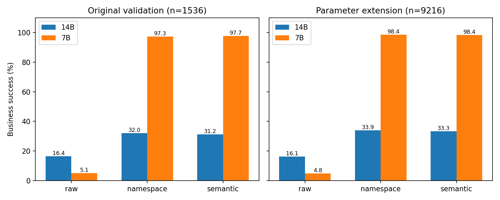
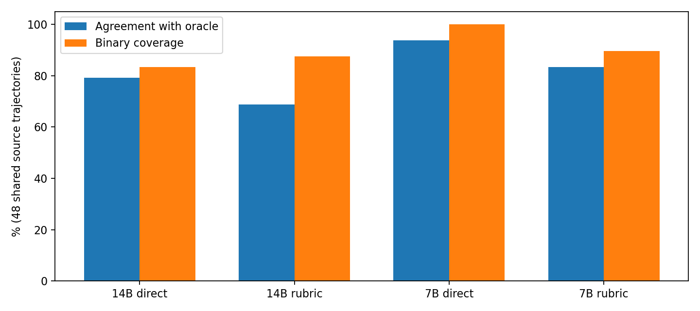

# 双卡 Agent 恢复与评测器压力实验报告

## 可以确认的结论

这轮研究验证了执行层如何影响 Agent 的任务成功，以及同一证据经过不同组织方式后 Judge 是否保持一致。它没有训练或微调模型。原冻结批次与新增参数场景批次分别统计，不与开发试跑合并。

完整证据已下载并独立核验：11,647 个归档文件通过 SHA256；10,752 条 Agent 轨迹逐条重放，与已保存评分一致；768 条 Judge 记录重新检查输入构造、输出解析、判分来源及 token 计数。

在本任务合同下，给请求 ID 加操作命名空间已解释绝大部分成功率收益。semantic 进一步按业务操作去重，但不能声称它稳定优于 namespace。7B 在本部署和两类合成任务上的结果优于 14B，不构成通用模型能力排名。

## 范围与实际运行

正式 Agent：2 模型 × 2 任务族 × 2 规模 × 4 变体 × 2 提示 × 2 故障条件 × 3 策略 × 4 重复 = 1536。扩展：变体增加到48，每格2重复，共9216。Judge：预先固定48条正式轨迹 × 2模型 × 2提示 × 4证据视图 = 768。

两类任务为发布审批/部署与订单库存/发运；故障为第一次成功写入已经提交但响应丢失。模型为 Qwen2.5-7B/14B-Instruct-AWQ，vLLM 0.7.3，16K 上下文；Agent 温度0.2，最多24次模型调用，每次最多1024输出token；Judge 温度0，最多384输出token。所有干预发生在执行层，模型原始参数与实际执行参数均留存。

原批次开始 10-16 22:54:55，结束 10-17 00:25:45；扩展推理开始 10-17 00:26:56，最后区块结束 10-17 09:10:33，清理结束 10-17 09:10:39（北京时间）。从原批次开始到全部清理约 10.26 小时。所有候选已跑完，因此没有为凑满12小时空转。恢复检查时两卡均0%利用率、各1MiB显存；这不是全程GPU利用率积分。

## 原冻结批次

|模型|执行策略|主要成功|严格成功（含初末观测）|有重复提交|有ID冲突|模型调用|总token|
|---|---|---|---|---|---|---|---|
|14B|namespace|82/256（32.03%）|79/256（30.86%）|0|0|1108|1,947,615|
|14B|raw|42/256（16.41%）|42/256（16.41%）|1|66|1301|2,785,224|
|14B|semantic|80/256（31.25%）|77/256（30.08%）|0|0|1139|1,985,524|
|7B|namespace|249/256（97.27%）|247/256（96.48%）|0|0|1720|1,990,653|
|7B|raw|13/256（5.08%）|8/256（3.12%）|45|250|3896|11,777,663|
|7B|semantic|250/256（97.66%）|247/256（96.48%）|0|0|1741|2,036,861|

主要成功要求完整业务状态正确且没有重复提交；严格成功额外要求写入前读初态、提交后读终态。终止标记 actor_finished 仅表示模型停止调用工具，不代表成功。

|模型|配对比较|修复|退化|净变化（百分点）|场景簇 bootstrap 95% 区间|
|---|---|---|---|---|---|
|14B|raw->semantic|55/256|17/256|+14.84|[+12.50, +17.19]|
|14B|raw->namespace|60/256|20/256|+15.62|[+11.33, +19.14]|
|14B|namespace->semantic|39/256|41/256|-0.78|[-5.47, +2.34]|
|7B|raw->semantic|237/256|0/256|+92.58|[+87.11, +96.88]|
|7B|raw->namespace|236/256|0/256|+92.19|[+84.77, +97.27]|
|7B|namespace->semantic|2/256|1/256|+0.39|[-1.17, +2.34]|

终止类型（所有策略合计）：`{"actor_finished": 1271, "model_call_limit": 109, "output_truncated": 152, "execution_error": 4}`。

## 独立参数扩展批次

|模型|执行策略|主要成功|严格成功（含初末观测）|有重复提交|有ID冲突|模型调用|总token|
|---|---|---|---|---|---|---|---|
|14B|namespace|521/1536（33.92%）|505/1536（32.88%）|1|0|6962|12,601,444|
|14B|raw|248/1536（16.15%）|246/1536（16.02%）|4|363|7545|15,354,019|
|14B|semantic|512/1536（33.33%）|490/1536（31.90%）|0|0|7016|12,378,404|
|7B|namespace|1512/1536（98.44%）|1483/1536（96.55%）|0|0|9990|11,659,560|
|7B|raw|74/1536（4.82%）|58/1536（3.78%）|263|1519|23002|66,580,996|
|7B|semantic|1511/1536（98.37%）|1483/1536（96.55%）|0|0|9918|11,723,990|

主要成功要求完整业务状态正确且没有重复提交；严格成功额外要求写入前读初态、提交后读终态。终止标记 actor_finished 仅表示模型停止调用工具，不代表成功。

|模型|配对比较|修复|退化|净变化（百分点）|场景簇 bootstrap 95% 区间|
|---|---|---|---|---|---|
|14B|raw->semantic|388/1536|124/1536|+17.19|[+14.84, +19.53]|
|14B|raw->namespace|411/1536|138/1536|+17.77|[+15.30, +20.31]|
|14B|namespace->semantic|286/1536|295/1536|-0.59|[-3.78, +2.60]|
|7B|raw->semantic|1439/1536|2/1536|+93.55|[+92.19, +94.92]|
|7B|raw->namespace|1439/1536|1/1536|+93.62|[+92.25, +94.99]|
|7B|namespace->semantic|9/1536|10/1536|-0.07|[-0.52, +0.39]|

终止类型（所有策略合计）：`{"actor_finished": 7718, "output_truncated": 843, "model_call_limit": 636, "execution_error": 19}`。

## 分层结果

以下分层将两个模型合并，仅用于看条件差异；模型间异质性需结合上表。完整计数、成本和终止分布在 verified-analysis.json。

|扩展条件|raw|namespace|semantic|
|---|---|---|---|
|family=fulfillment|304/1536（19.79%）|1005/1536（65.43%）|1020/1536（66.41%）|
|family=release|18/1536（1.17%）|1028/1536（66.93%）|1003/1536（65.30%）|
|size=3|201/1536（13.09%）|1102/1536（71.74%）|1109/1536（72.20%）|
|size=5|121/1536（7.88%）|931/1536（60.61%）|914/1536（59.51%）|
|strategy=minimal|241/1536（15.69%）|1106/1536（72.01%）|1094/1536（71.22%）|
|strategy=recovery|81/1536（5.27%）|927/1536（60.35%）|929/1536（60.48%）|
|fault=False|181/1536（11.78%）|1016/1536（66.15%）|1019/1536（66.34%）|
|fault=True|141/1536（9.18%）|1017/1536（66.21%）|1004/1536（65.36%）|

## Judge：准确性、拒评与证据扰动

每行都是同一组48条源轨迹，不能把各视图合成独立样本。误放行分母是真实失败数，误拒绝分母是真实成功数；拒评单列，避免因拒评变多而误认为错误率下降。缺证据视图依据明确规则应拒评，不用于衡量对真实业务成功的识别能力。

|模型|提示|视图|正确/48|误放行/真实失败|误拒绝/真实成功|拒评|二元覆盖|总token|
|---|---|---|---|---|---|---|---|---|
|14B|direct|compact|38/48|1/19（5.26%）|2/29（6.90%）|7/48|41/48|55,323|
|14B|direct|distractor|37/48|2/19（10.53%）|2/29（6.90%）|7/48|41/48|128,405|
|14B|direct|full|38/48|1/19（5.26%）|1/29（3.45%）|8/48|40/48|124,161|
|14B|direct|missing|48/48|N/A|N/A|48/48|0/48|31,450|
|14B|rubric|compact|34/48|5/19（26.32%）|7/29（24.14%）|2/48|46/48|60,867|
|14B|rubric|distractor|37/48|6/19（31.58%）|2/29（6.90%）|3/48|45/48|133,777|
|14B|rubric|full|33/48|5/19（26.32%）|4/29（13.79%）|6/48|42/48|129,522|
|14B|rubric|missing|48/48|N/A|N/A|48/48|0/48|36,609|
|7B|direct|compact|38/48|1/19（5.26%）|9/29（31.03%）|0/48|48/48|55,365|
|7B|direct|distractor|45/48|1/19（5.26%）|1/29（3.45%）|1/48|47/48|128,106|
|7B|direct|full|45/48|1/19（5.26%）|2/29（6.90%）|0/48|48/48|123,833|
|7B|direct|missing|47/48|N/A|N/A|47/48|1/48|31,263|
|7B|rubric|compact|38/48|1/19（5.26%）|7/29（24.14%）|2/48|46/48|60,710|
|7B|rubric|distractor|38/48|1/19（5.26%）|5/29（17.24%）|4/48|44/48|133,501|
|7B|rubric|full|40/48|1/19（5.26%）|2/29（6.90%）|5/48|43/48|129,238|
|7B|rubric|missing|48/48|N/A|N/A|48/48|0/48|36,625|

|模型|提示|相对full的视图|判定翻转|改对|改错|总token相对full|
|---|---|---|---|---|---|---|
|14B|direct|compact|8/48|4|4|0.446|
|14B|direct|distractor|4/48|1|2|1.034|
|14B|rubric|compact|9/48|5|4|0.470|
|14B|rubric|distractor|5/48|4|0|1.033|
|7B|direct|compact|9/48|1|8|0.447|
|7B|direct|distractor|2/48|1|1|1.035|
|7B|rubric|compact|12/48|5|7|0.470|
|7B|rubric|distractor|6/48|2|4|1.033|

7B direct 从 full 改为 compact 时，正确数45→38，误拒绝2→9；虽然完整状态和提交事实仍被保留，省token并不等于判定不受影响。rubric 也没有统一提升效果：7B full 的正确数45→40，拒评0→5。报告所有视图，不能事后只挑最好的一行。

768条都能解析为规定JSON；格式通过不等于业务判定正确。missing视图总共192次中191次按要求拒评，另1次作出二元判定。证据键是否存在也不等于解释忠实；本轮没有验证解释的因果忠实性。

## 统计与因果边界

配对键为模型、任务族、规模、变体、提示、故障和重复编号；比较不同策略下新生成的完整轨迹，不强制后续动作一致，也没有共同随机数控制。修复与退化描述配对条件的结果变化，不能当作同一条随机轨迹的个体因果反事实。

区间用变体编号作为簇，同时保留该变体下两类任务、两种规模、所有提示/故障/重复/策略；在每个模型内对簇重采样10000次，固定随机种子20261017，给出百分位区间。正式批只有4个簇，区间非常有限；扩展48簇仍只属于两类合成合同，其中发布任务主要是标识符和排列变化。这是条件化稳定性描述，不是跨领域总体置信保证。未作多重比较校正。

raw 的全局 request_id 缓存可能让模型在不同工具/对象间复用ID时发生冲突。namespace 用原ID+操作签名区分这些请求；semantic 再去掉原ID。这依赖任务明确规定每个业务操作只能提交一次。对合法重复扣款、相同工具参数但不同业务意图等情形，semantic 可能错误合并，本实验不能推广到这些业务。

protected字段在当前工具接口中缺乏有效修改路径，因此保护对象检查不能证明模型面对可修改越权工具时的能力。初态/终态/提交日志由模拟环境直接提供给Judge，比真实线上日志完整得多；没有人工标注、一致性评审或生产验证。

## 失败留档与可复现性

正式批4条、扩展19条execution_error均保留。服务日志另存，HTTP400需与对应token长度限制核验；解析器报错可能被服务转换成文本输出，因此应结合轨迹和业务评分，不只看进程退出码。所有调用上限和输出截断均留在分母。

本次未修改模型权重、未支付外部API、没有新增GPU租赁。归档不包含SSH密钥或模型权重；token为已返回usage的总量，失败请求没有usage时不能据此推算完整计费成本。时长为墙钟时间和逐请求延迟，不等于连续GPU有效计算时长。

公开证据：[核验分析](verified-analysis.json)、[真实案例](案例解读.md)、[阅读与复现说明](README.md)。完整原始归档及服务日志保留在本地，未上传至本仓库；本仓库提供三个案例的全部执行条件记录，不能仅凭这些案例重新计算全量统计。
